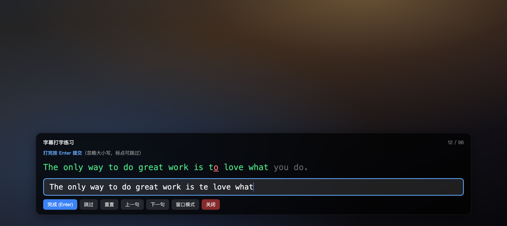
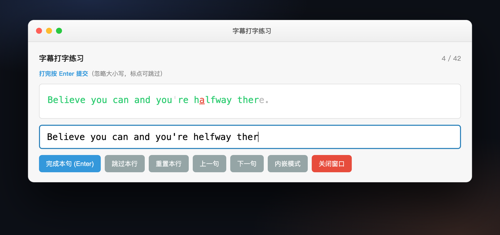

# IINA Subtitle Typing

> 在 [IINA](https://iina.io) 里一边看片，一边逐句打字跟读的插件。
> 字幕出现 → 视频循环播放这一句 → 你跟着打字 → 打对才放行下一句。

[](https://iina.io)
[](LICENSE)
[](CHANGELOG.md)

纯 JavaScript 实现的 IINA 插件，**没有构建步骤、没有第三方依赖、不联网**。



---

## 目录

- [这是什么](#这是什么)
- [功能特性](#功能特性)
- [两种输入模式](#两种输入模式)
- [安装](#安装)
- [使用](#使用)
- [字幕准备](#字幕准备)
- [设置项](#设置项)
- [工作原理](#工作原理)
- [项目结构](#项目结构)
- [开发](#开发)
- [已知限制](#已知限制)
- [常见问题](#常见问题)
- [文档](#文档)
- [License](#license)

---

## 这是什么

学外语最枯燥的两件事：背单词、练听力。看片的时候字幕一闪而过，看完什么都没留下。

这个插件把「看片」变成「逐句跟读练习」：

1. 视频播放到一句字幕，插件把它单独拎出来；
2. 这一句在 A-B 循环里反复播放，你可以反复听；
3. 你在输入框里把这句话**一字不差地打出来**，打对的位置变绿、打错的变红；
4. 整句打对 → 解锁这一段 → 视频继续播到下一句 → 自动暂停 → 下一句开始。

不用切出去开别的软件，不用手写笔记，键盘上敲完就是记住了。

**适用场景**：美剧/电影/纪录片学英语、日语动漫台词跟读、演讲和播客练听力、歌词打字。

---

## 功能特性

| 功能 | 说明 |
| --- | --- |
| **逐句 A-B 循环** | 当前句自动循环播放，打对之前可以无限次重听 |
| **逐字符实时比对** | 正确**绿**、错误**红**、待输入灰，退格修正即时生效 |
| **打对自动放行** | 整句输入正确后自动继续播放到下一句并暂停 |
| **两种输入面板** | 视频内嵌悬浮面板 / 独立 macOS 窗口，随时切换 |
| **双字幕来源** | 外挂 SRT 文件（可预读全文、有进度） / 视频内嵌软字幕（实时跟随） |
| **盲打模式** | 隐藏原句，凭听感默写，提交后一次性给出红绿对错结果 |
| **智能循环区间** | 根据与下一句的间隔自动延长循环尾部，避免话说一半就跳回 |
| **正确率统计** | 练习结束给出按字符计算的正确率与句数 |
| **手动控制** | 跳过、重置、上一句、下一句，全部有菜单项和面板按钮 |
| **中文 OSD 提示** | 状态变化在播放器画面上直接提示 |

### 键盘/面板快捷操作

- **Enter**：提交本句（盲打模式下第一次 Enter 看结果，第二次 Enter 进入下一句）
- **Backspace**：修正，计入「修正次数」
- **菜单 → 插件 → iina-typing-practice**：开始练习 / 切换输入模式 / 上一句 / 下一句 / 跳过本行 / 重置本行 / 切换盲打模式

---

## 两种输入模式

**内嵌模式（默认）** —— 面板悬浮在视频画面底部，不离开播放器窗口，适合全屏看片。


**独立窗口模式** —— 独立的 macOS 窗口，浅色主题、等宽字体、按钮更大，适合窗口化播放或多屏。



随时可以通过菜单「切换输入模式（内嵌/窗口）」或面板上的「窗口模式 / 内嵌模式」按钮互换，当前句子会带过去。

---

## 安装

### 方式一：从 GitHub 仓库安装（推荐，可自动更新）

1. IINA → 设置 → 插件（Settings → Plugins）
2. 点「从 GitHub 安装」/ `Install from GitHub`，填入：

   ```
   silenceZXH/IINA-Subtitle-Typing
   ```

3. 按提示确认插件权限（OSD 提示、文件读取、视频叠加层）。

装好之后 IINA 会读取 `Info.json` 里的 `ghVersion`，与仓库 `main` 分支上的值比较，有新版本时提示更新。

### 方式二：下载发布包

从 [Releases](https://github.com/silenceZXH/IINA-Subtitle-Typing/releases) 下载 `iina-typing-practice-x.y.z.iinaplgz`，双击用 IINA 打开即可安装（`.iinaplgz` 就是改了扩展名的 zip）。

### 方式三：本地开发安装

```bash
git clone https://github.com/silenceZXH/IINA-Subtitle-Typing.git
cd IINA-Subtitle-Typing
./build.sh --link      # 打包 + 以开发版插件链接进 IINA
```

`--link` 会在 `~/Library/Application Support/com.colliderli.iina/plugins/` 下创建 `.iinaplugin-dev` 软链接，之后改代码只需要在 IINA 里「重新载入所有插件」。

> 要求 IINA ≥ 1.4.0（插件系统从 1.4.0 开始提供）。本项目在 IINA 1.4.4 / macOS 上开发验证。

---

## 使用

1. 用 IINA 打开一个**带字幕**的视频（同目录有同名 `.srt`，或者视频里带软字幕轨）。
2. 加载成功会看到 OSD 提示：`已加载外挂字幕 N 条` 或 `检测到内嵌字幕，实时跟随模式`。
3. 菜单 → 插件 → **开始打字练习**。
4. 面板出现，视频从当前句开始循环播放。
5. 一边听一边把字幕打出来：
   - 打对的字符变绿，打错的变红，还没打的保持灰色；
   - 标点符号自动豁免，不用纠结 `,` `.` `'`；
   - **大小写不敏感**。
6. 整句打对 → 按 **Enter** → 视频继续播放到下一句并自动暂停。
7. 想跳过就点「跳过」，想重听就点「重置」，想换句就「上一句 / 下一句」。
8. 视频播完或最后一句打完，面板显示总正确率。

---

## 字幕准备

插件支持两条路径，**优先用外挂 SRT**（能一次读完整份字幕，有 `12 / 96` 这样的进度，体验最好）。

### A. 外挂字幕（推荐）

把字幕文件放在视频**同一个目录**、**同名**即可：

```
Movies/
├── Interstellar.2014.mkv
└── Interstellar.2014.srt     ← 插件会自动找它
```

插件按 `.srt` → `.ass` → `.ssa` 的顺序查找。只要字幕文件存在，IINA 里不用手动挂载。

### B. 视频内嵌软字幕

MKV 里自带的字幕轨也可以练。插件在播放时实时读取当前字幕条目，字幕出现即进入打字，打完继续播放等下一条。

内嵌模式没有「总共多少句」（没法预先知道），所以进度显示为「内嵌字幕模式」，也**不支持上一句**（用进度条拖回去即可）。

### C. 硬字幕/图片字幕

**不支持**。画面上烧进画面的字幕、以及 PGS/VobSub 这类图形字幕无法被读取。

---

## 设置项

IINA → 设置 → 插件 → iina-typing-practice → 设置，四项参数控制 A-B 循环的节奏：

| 设置项 | 默认值 | 含义 |
| --- | --- | --- |
| `abPauseDuration` | `1.0` 秒 | 每次循环到结束前暂停多久再跳回开头（0 = 不暂停） |
| `abExtendDuration` | `2.0` 秒 | 和下一句间隔较大时，循环尾部延长几秒以听完余音 |
| `abGapThreshold` | `1.0` 秒 | 下一句与当前句的间隔超过此值才延长，否则不延长 |
| `abShortSubThreshold` | `1.5` 秒 | 字幕时长不超过此值时不暂停（太短的句子循环起来体验差） |

修改立即保存到 IINA 的插件偏好，**重新开始练习**后生效。

---

## 工作原理

```
                    ┌─────────────────────────────┐
   视频加载 ────────► │ loadSubtitles()             │
                    │  ① 同目录 .srt/.ass/.ssa     │──► parseSRT() ──► state.subtitles
                    │  ② core.subtitle.tracks      │──► source = "embedded"
                    └─────────────────────────────┘
                                 │
   菜单「开始打字练习」 ──────────► startPractice()
                                 │
              ┌──────────────────┴───────────────────┐
              ▼                                      ▼
   外挂 SRT 模式                             内嵌字幕模式
   findCurrentSubtitleIndex()                startEmbeddedFollowMode()
              │                              轮询 mpv sub-text
   enterExternalTyping(i)                   字幕出现 → enterEmbeddedTyping()
   seekTo(start) + startABLoop()                      │
              └──────────────┬───────────────────────┘
                             ▼
              pushToInput("load-sentence", {...})
                             │
                    ┌────────┴─────────┐
                    ▼                  ▼
             overlay.postMessage   standaloneWindow.postMessage
                    │                  │
                    └────────┬─────────┘
                             ▼
                  面板逐字符渲染（绿/红/灰）
                             │
                   按 Enter → typed-correct {errors, corrections}
                             │
                    onTypedCorrect() → stopABLoop() → resume
                             │
              播到下一句起点 → 暂停 → enterExternalTyping(next)
```

**状态机**（`state.mode`）：

```
IDLE ──开始练习──► TYPING ──打对──► PLAYING ──到下一句──► TYPING
                     ▲                  │
                     └──────跳过/重置────┘
                                     └──视频结束──► DONE
IDLE ──开始练习(内嵌)──► PLAYING_WAITING ──字幕出现──► TYPING ──打对──► PLAYING_WAITING
```

**用到的 IINA API**：

| API | 用途 |
| --- | --- |
| `core.pause()` / `core.resume()` / `core.seekTo()` | 播放控制与循环跳转 |
| `core.status.position` / `core.status.duration` | 轮询播放位置以判断循环与换句 |
| `core.subtitle.tracks` | 检测内嵌字幕轨 |
| `core.osd()` | 状态提示 |
| `mpv.getString("sub-text")` / `mpv.getNumber("sub-start"/"sub-end")` | 读取内嵌字幕文本与时间范围 |
| `file.read()` | 读取外挂字幕文件 |
| `overlay.loadFile()` / `overlay.postMessage()` / `overlay.onMessage()` | 视频内嵌输入面板 |
| `standaloneWindow.*` | 独立窗口输入面板 |
| `menu.addItem()` | 插件菜单项 |
| `iina.preferences` | 读写设置项 |

**为什么不监听全局键盘**：插件只处理自己面板里的 `<input>`，不装键盘钩子、不需要辅助功能权限，关掉面板即退出练习。

---

## 项目结构

插件遵循 IINA 官方约定：**仓库根目录就是插件包根目录**（`Info.json` 必须在根，IINA 才能直接从 GitHub 安装和检查更新）。

```
IINA-Subtitle-Typing/
├── Info.json                     # 插件清单：名称、版本、入口、权限、默认设置、更新信息
├── src/
│   └── main.js                   # 全部插件逻辑（字幕解析 / A-B 循环 / 状态机 / 消息通信）
├── ui/
│   ├── overlay-input.html        # 内嵌输入面板（深色半透明）
│   ├── input-window.html         # 独立窗口输入面板（浅色）
│   └── preferences.html          # 设置页
├── docs/
│   ├── PRD.md                    # 产品需求文档
│   ├── architecture.md           # 代码库理解与架构梳理（逐函数说明）
│   └── development-plan.md       # 开发计划与 IINA API 调研结论
├── screenshots/                  # README 截图
├── build.sh                      # 打包脚本（生成 dist/*.iinaplgz）
├── .github/workflows/release.yml # 打 tag 自动构建并发布产物
├── CHANGELOG.md
└── LICENSE
```

`src/main.js` 各模块职责：

| 模块 | 职责 |
| --- | --- |
| `getSettings()` | 从 `iina.preferences` 读四项循环参数，带默认值与容错 |
| `parseSRT()` / `parseTime()` / `stripStyleTags()` | SRT 解析：兼容 BOM、CRLF、`{...}` 样式标签、去重、按时间排序 |
| `loadSubtitles()` | 先找同目录外挂字幕，再退回内嵌字幕检测 |
| `startABLoop()` / `stopABLoop()` | 50ms 轮询播放位置，到阈值暂停 / 跳回 |
| `enterExternalTyping()` | 跳到句子起点、计算循环终点、推送句子到面板 |
| `startEmbeddedFollowMode()` / `enterEmbeddedTyping()` | 轮询 `sub-text` 从空变为非空时触发新句子 |
| `pushToInput()` | 双模式通信抽象，按 `state.inputMode` 发到 overlay 或 standardaloneWindow |
| `handleInputAction()` | 面板动作分发（typed-correct / skip / reset / next / prev / 切换模式 / 关闭） |
| `computeAccuracy()` | 按字符统计正确率 |

---

## 开发

```bash
git clone https://github.com/silenceZXH/IINA-Subtitle-Typing.git
cd IINA-Subtitle-Typing
./build.sh --link     # 打包并注册为开发版插件
```

改完代码后在 IINA 里执行 **菜单 → 插件 → 重新载入所有插件**（或重启 IINA）查看效果。

**打包**：`./build.sh` 会读取 `Info.json` 里的 `name` 和 `version`，生成 `dist/iina-typing-practice-<version>.iinaplgz`（zip 结构为插件根目录内容，不带外层文件夹）。

**发布新版本**（手动流程）：

1. 修改 `Info.json` 的 `version`，并把 `ghVersion` 加 1；
2. 更新 `CHANGELOG.md`；
3. 提交后打 tag：`git tag v0.4.1 && git push origin v0.4.1`；
4. GitHub Actions 会自动构建并把 `.iinaplgz` 上传到该 Release。

> `ghVersion` 是 IINA 判断「有没有新版本」的依据（整数，每次发布必增）。`version` 是给人看的语义化版本号。两个字段都要改。

---

## 已知限制

这些是当前实现的真实边界，不是 bug 列表，使用前值得知道：

1. **外挂 `.ass/.ssa` 会被尝试读取，但解析器是 SRT 专用的**，ASS 的 `Dialogue:` 行解析不出内容，实际会退回内嵌字幕模式。想要稳定体验请用 `.srt`。
2. **内嵌字幕模式没有总句数和进度**，也不支持「上一句」，只能跟随播放位置。
3. **盲打模式只隐藏面板里的原句**，IINA 自己在画面上渲染的字幕仍然可见——真想盲打需要手动关掉播放器字幕。
4. **正确率按字符数计算**（分母含空格），而比对时标点已被豁免，两者口径不完全一致，正确率可能略低于体感。
5. **练习统计只存在内存里**，关掉面板或退出练习即清空，没有历史记录和断点续练。
6. **没有暂停/恢复练习**，关闭面板等于结束本次练习。
7. **输入面板依赖 IINA 的 webview 消息通道**：面板刚打开时的句子通过 `request-current` 拉取，有 250ms × 8 次的兜底重试，极端情况下可能显示「准备中...」。
8. 需要在 macOS 上使用，`overlay` 内嵌模式依赖 IINA 的 video-overlay 能力。

---

## 常见问题

**Q：点「开始打字练习」没反应 / 没有面板？**
A：先确认视频已经加载完（OSD 有提示字幕条数）。如果提示「未找到字幕」，说明既没有同名 SRT 也没有内嵌软字幕轨。

**Q：字幕加载了但句子里有 `<i>`、`{\an8}` 之类的残留？**
A：`parseSRT()` 会去掉 `{...}` 样式标签；SRT 内联的 `<i>/<b>` 标签目前不会处理，建议用纯文本字幕。

**Q：提示「已加载外挂字幕」但句子对不上画面？**
A：多半是字幕文件与视频版本（片源帧率/剪辑）不匹配。换一份对齐的字幕即可，插件本身只按时间轴取句。

**Q：内嵌模式完全不动？**
A：确认视频里选中的是**文本**字幕轨（不是 PGS/VobSub 图形字幕），且该轨道能在画面上正常显示文字。

**Q：中文/日文能练吗？**
A：可以，比对逻辑对中日文字符有白名单处理。

**Q：怎么改插件行为？**
A：所有逻辑都在 `src/main.js` 和三个 HTML 里，没有构建步骤，直接改即可。

---

## 文档

- [产品需求文档](docs/PRD.md) —— 功能定义与边界
- [代码库理解与架构梳理](docs/architecture.md) —— 逐文件、逐函数的实现说明
- [开发计划](docs/development-plan.md) —— IINA API 调研结论与技术风险预案
- [更新日志](CHANGELOG.md)

---

## License

[MIT](LICENSE) © 2026 Aaron

---

> 说明：`screenshots/` 中的截图由插件的真实 HTML/CSS 渲染生成，句子为示例内容。
